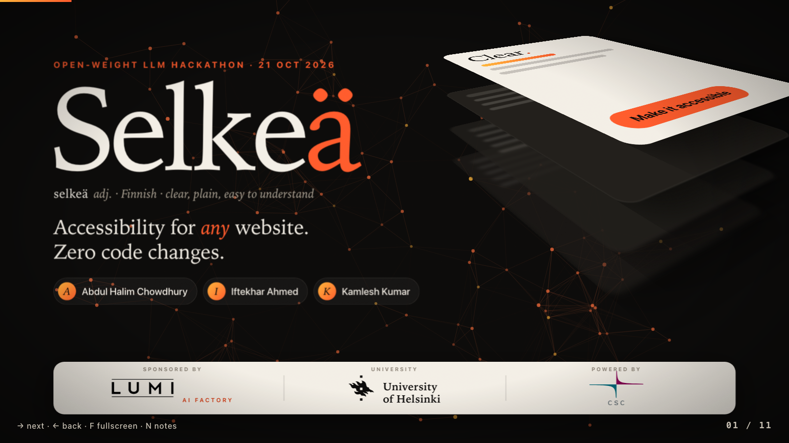
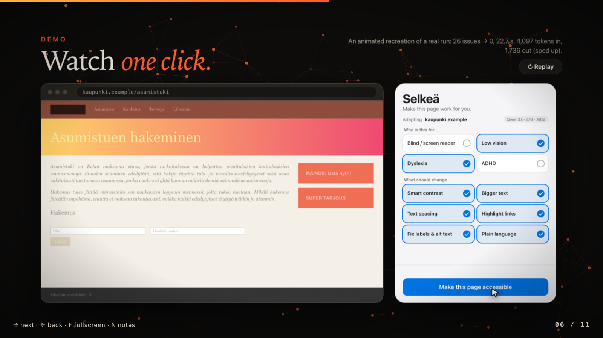
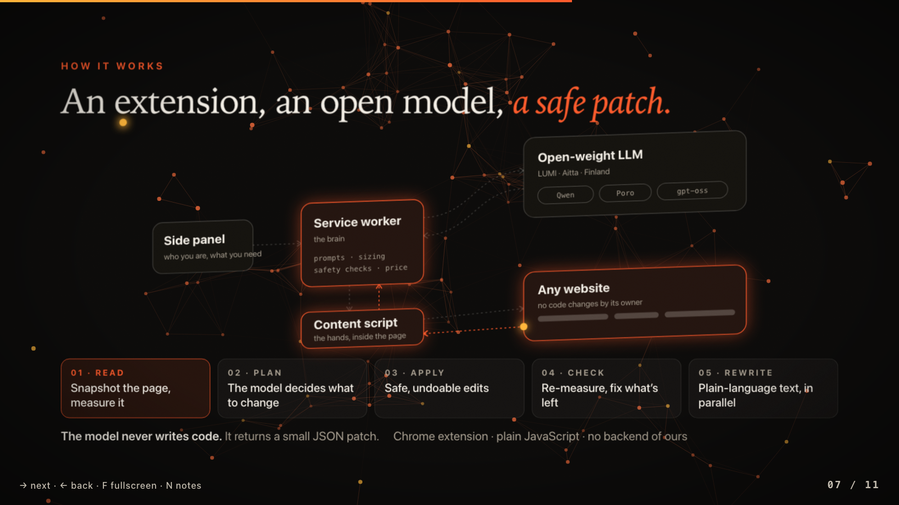

# Selkeä

Accessibility for any website, with zero code changes.
Built at the LUMI AI Factory Open Weight LLM Hackathon, University of Helsinki, 21 October 2026.

Selkeä ("clear" in Finnish) is a Chrome extension. You pick who you are (low vision, dyslexia, ADHD and so on) and what you need. An open-weight model on LUMI Aitta reads a compact snapshot of the page and answers with a small patch of CSS, attributes and text. The extension checks the patch, applies it live, measures the page again, and one click undoes everything. The website's owner changes nothing.

## Presentation

**[Open the live presentation](https://kamleshkumar427.github.io/selkea-presentation/)**
Arrow keys to move, `F` for fullscreen, `N` for speaker notes. You can also open `presentation/index.html` straight from this repo in a browser. It is one self-contained file with no build step.

<p>
  
  
  
</p>

## Run the extension

1. Open `chrome://extensions`, switch on **Developer mode**, click **Load unpacked** and choose `selkea-extension/`.
2. Click the Selkeä icon. A side panel opens.
3. Open **Settings**, pick a model and paste its key. For LUMI Aitta, make a token at [aitta-auth.csc.fi/myToken](https://aitta-auth.csc.fi/myToken).
4. Open any website, tick who you are, and press **Make this page accessible**.

Full details, the safety model and the numbers behind the demo are in [`selkea-extension/README.md`](selkea-extension/README.md).

## Keys and private servers

No key, token or server address is committed to this repo. Two ways to provide them:

- **Easiest.** Paste the key into the extension's Settings panel. Chrome stores it in your browser only.
- **From a `.env` file.** Useful for the university hackathon servers, which are only reachable by event participants.
  ```bash
  cp .env.example .env          # then fill in your values
  node scripts/make-config.mjs  # writes selkea-extension/config.local.js
  ```
  Reload the extension afterwards. Both `.env` and `config.local.js` are git-ignored. Without them the extension offers only the public Aitta models.

The hackathon servers were switched on for the event only, so they may be offline.

## What is in here

| Path | What it is |
|---|---|
| `selkea-extension/` | The Chrome extension (plain JavaScript, no build step, no backend) |
| `presentation/` | The 3D motion presentation, one self-contained HTML file |
| `docs/previews/` | Screenshots used in this README |
| `scripts/` | `make-config.mjs` (.env to extension config), `publish-presentation.sh` |
| `.github/workflows/pages.yml` | Publishes `presentation/` to GitHub Pages |
| `idea.md` | The original plan we started from |

## Team

Iftekhar Ahmed, Kamlesh Kumar and Abdul Halim Chowdhury.

## Thanks

Prof. Keijo Heljanko for organising the day, the [LUMI AI Factory](https://lumi-ai-factory.eu/) team and CSC for the Aitta access, the University of Helsinki, and the EuroHPC Joint Undertaking and the Ministry of Education and Culture for sponsoring.
